<p align="center">
<picture>
  <source media="(prefers-reduced-motion: reduce) and (prefers-color-scheme: dark)" srcset="assets/poster-dark.png">
  <source media="(prefers-reduced-motion: reduce)" srcset="assets/poster-light.png">
  <source media="(prefers-color-scheme: dark)" srcset="assets/cover-dark.webp" type="image/webp">
  <source srcset="assets/cover-light.webp" type="image/webp">
  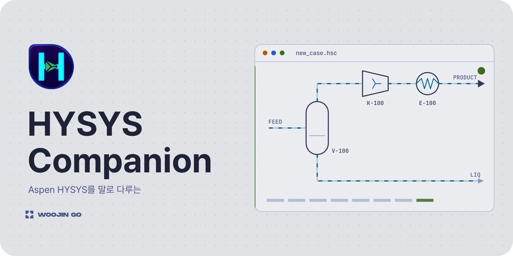
</picture>
</p>

<p align="center">
  <b>Aspen HYSYS를 말로 다루는<br>Windows 데스크톱 앱</b><br>
  A Windows desktop app that works beside Aspen HYSYS
</p>

<p align="center">
  <a href="https://github.com/wjgoarxiv/hysys-companion-releases/releases/latest"></a>
  
</p>

<p align="center">
  <a href="#ko">한국어</a> · <a href="#en">English</a> · <a href="https://github.com/wjgoarxiv/hysys-companion-releases/releases/latest"><b>다운로드 / Download</b></a> · <a href="https://wjgoarxiv.github.io/hysys-companion-releases/"><b>소개와 튜토리얼 / Intro and tutorial</b></a>
</p>

<br>

<a id="ko"></a>

# 한국어

[다운로드](#다운로드) · [소개와 튜토리얼](#소개와-튜토리얼) · [기능](#기능) · [설치와 업데이트](#설치와-업데이트) · [요구 사항](#요구-사항) · [자주 묻는 질문](#자주-묻는-질문)

HYSYS Companion은 Aspen HYSYS 옆에서 쓰는 Windows 데스크톱 앱이에요. 새 케이스를 말이나 PFD 그림으로 만들고, 열려 있는 케이스에 묻고, 말로 바꿔요. 바뀔 내용을 먼저 보여주고, 승인한 뒤에만 HYSYS에 적용해요.

이 저장소에는 설치 파일, 소개와 튜토리얼 사이트, 예시 데이터로 도는 화면 데모가 있어요. 앱의 엔진 코드는 들어 있지 않아요.

## 다운로드

**[최신 설치 파일 받기](https://github.com/wjgoarxiv/hysys-companion-releases/releases/latest)**

릴리스 페이지의 `HYSYSCompanion_Native_Setup_<버전>.exe` 가 설치 파일이에요. 앱 안에서도 새 버전을 확인하고 받을 수 있어요. [설치와 업데이트](#설치와-업데이트)를 보세요.

## 소개와 튜토리얼

설치하기 전에 브라우저에서 한곳에서 볼 수 있어요. "소개" 탭은 앱으로 무엇을 할 수 있는지 15장으로 보여줘요. 한국어와 영어로 볼 수 있어요. "튜토리얼" 탭은 연습 화면 위에서 안내 말풍선이 다음에 누를 곳을 짚어 줘요. 14단계를 직접 누르거나 "그냥 보기"로 지켜볼 수 있어요.

<p align="center">
  <a href="https://wjgoarxiv.github.io/hysys-companion-releases/#tutorial">
    <picture>
      <source media="(prefers-reduced-motion: reduce) and (prefers-color-scheme: dark)" srcset="assets/tutorial/poster-dark.png">
      <source media="(prefers-reduced-motion: reduce)" srcset="assets/tutorial/poster-light.png">
      <source media="(prefers-color-scheme: dark)" srcset="assets/tutorial/tutorial-dark.webp" type="image/webp">
      <source srcset="assets/tutorial/tutorial-light.webp" type="image/webp">
      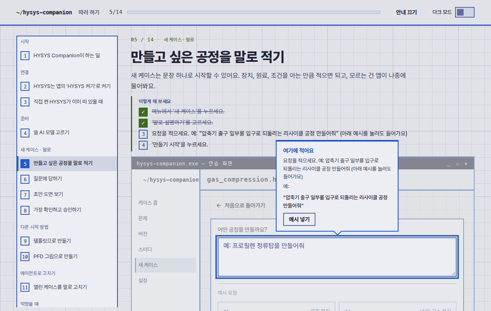
    </picture>
  </a>
</p>

<p align="center">
  <a href="https://wjgoarxiv.github.io/hysys-companion-releases/#intro"></a>
  <a href="https://wjgoarxiv.github.io/hysys-companion-releases/#tutorial"></a>
  <a href="https://wjgoarxiv.github.io/hysys-companion-releases/ui-shell/"></a>
</p>

- **소개와 튜토리얼**: [https://wjgoarxiv.github.io/hysys-companion-releases/](https://wjgoarxiv.github.io/hysys-companion-releases/). 처음이면 [소개](https://wjgoarxiv.github.io/hysys-companion-releases/#intro) 탭에서 15장으로 한눈에 보세요. 이어서 [튜토리얼](https://wjgoarxiv.github.io/hysys-companion-releases/#tutorial) 탭에서 직접 따라 해 보세요. 튜토리얼은 한국어만 있어요.
- **HTML 파일로 내려받기**: 페이지 위쪽의 HTML 버튼을 누르면 보고 있는 소개나 튜토리얼을 파일 하나로 받아요. 인터넷 없이 더블클릭으로 열려요. 바로 받기: [소개](https://wjgoarxiv.github.io/hysys-companion-releases/download/HYSYS-Companion-intro.html) · [튜토리얼](https://wjgoarxiv.github.io/hysys-companion-releases/download/HYSYS-Companion-tutorial.html). 받은 파일의 튜토리얼 진행 상황은 웹페이지와 따로 저장돼요.
- **화면 데모**: 앱의 실제 화면 코드를 예시 데이터로 돌려요. 빈 화면에서 말로 새 케이스를 시작해 질문, 초안, 승인 카드까지 눌러 볼 수 있어요. HYSYS나 AI에는 연결하지 않아서 케이스를 만들거나 열지는 못해요. 코드는 [`ui-shell/`](ui-shell/)에 있어요.

## 기능

### 새 케이스: 말이나 그림에서 시작해요

말로 설명하거나, PFD 그림(PNG, JPEG, PDF)을 올리면 앱이 초안 그림을 먼저 보여줘요. 초안을 말로 고치거나 직접 고친 뒤, 복사본에서 HYSYS 확인 계산을 돌려요. 계산이 끝나고 승인하면 케이스가 열려요.

<p align="center">
  <picture>
    <source media="(prefers-color-scheme: dark)" srcset="assets/workflow-dark.png">
    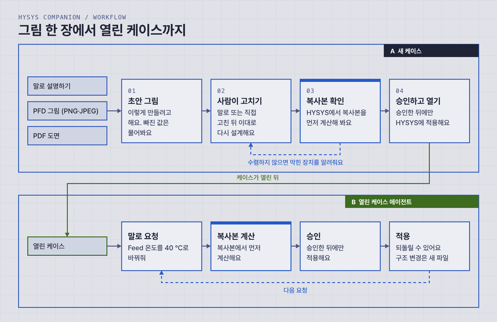
  </picture>
</p>

<p align="center">
  <picture>
    <source media="(prefers-color-scheme: dark)" srcset="assets/screens/newcase-approval-dark.png">
    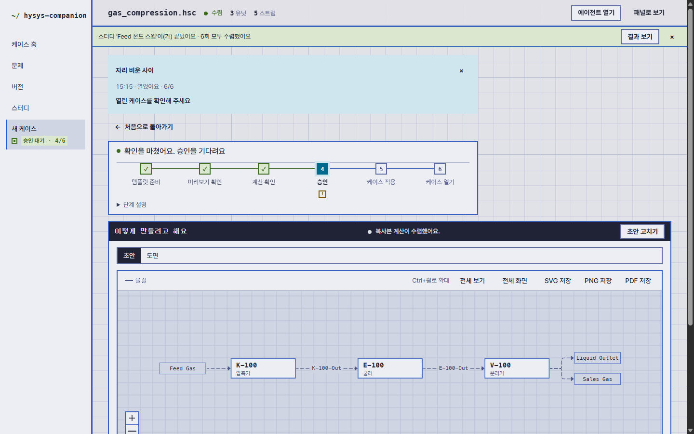
  </picture>
  <br>
  <sub>가스 압축 템플릿으로 만든 새 케이스가 승인을 기다리는 화면</sub>
</p>

- "이렇게 만들려고 해요" 카드에서 성분·스트림·조건·장치 값·이름·물성 패키지를 바로 고치고 되돌릴 수 있어요. 성분을 빼면 모든 스트림 조성이 100%로 다시 맞춰지고, 스트림에 적은 압력·온도는 HYSYS에 그대로 들어가요.
- 계산이 수렴하지 않은 케이스도 "수렴하지 않은 채로 열기"로 열 수 있어요. 열린 뒤에는 수렴하지 않은 재순환과 값이 정해지지 않은 스트림을 카드에 보여줘요. 열기에 실패해도 초안이 남아 있어요.
- 빠진 값은 추천값과 함께 물어보고, 앱이 채운 값은 결과에 모두 보여줘요. 채운 값에는 "자동 보정", "기본값", "AI 추정" 표시가 붙어요.
- 말로 만들 때는 공정을 웹에서 먼저 찾아 참고해요. 참고한 페이지는 초안 카드에 보여요. 설정 > 웹 자료 찾기에서 끌 수 있어요.
- 중간에 오류가 나거나 연결이 끊겨도 "멈춘 곳부터 다시"로 이어가요. 앞에서 만든 초안과 답변은 그대로 써요.
- 진행 카드가 지금 하는 일, 보통 걸리는 시간, 쉬운 단계 이름을 보여줘요. 카드 안의 취소 버튼으로 실제로 멈출 수 있어요.
- 새 케이스를 돌려 두고 다른 창에서 일하면, 승인 대기·답변 필요·멈춤·완료 때 Windows 알림과 작업표시줄 깜빡임으로 알려줘요. 돌아오면 "자리 비운 사이" 카드가 그동안 있었던 일을 보여줘요.
- 만든 케이스 사본은 `문서\HYSYS Companion\cases`에 저장돼요.
- 여러 쪽짜리 PDF는 쪽 미리보기에서 읽을 쪽을 골라요.
- 데모 PFD 다섯 장(LNG 기화, 가스 압축, 2단 플래시, 프로판 냉동, 혼합·감압)으로 바로 시작해 볼 수 있어요.

### 열린 케이스: 묻고, 고치고, 되돌려요

- **케이스 홈**: HYSYS에서 연 케이스의 흐름도와 "먼저 볼 문제"가 바로 보여요. 다른 케이스로 바꾸면 따라와요.
- **문제**: 수렴하지 않는 장치의 원인과 고칠 값을 보여줘요. 승인하면 적용해요.
- **에이전트**: "Feed 온도를 40 °C로 바꿔줘"처럼 말로 바꿔요. 바뀔 값을 전후로 미리 보여주고, 승인한 뒤에만 적용하고, 되돌릴 수 있어요. 구조를 바꾸면 원본은 두고 `_vN.hsc` 새 파일을 만들어요.
- **질문**: "이 탑의 환류비는?"처럼 물으면 열린 케이스의 실제 값으로 답해요. 파일에서 못 찾은 값은 못 찾았다고 말해요.
- **버전**: 스냅샷을 저장하고, 두 버전을 값과 단위까지 비교하고, 이전 버전을 새 파일로 열어요.
- **스터디**: 설계 케이스 표, 값 바꿔 보기(스윕), Dynamics 실행을 복사본에서 하나씩 차례로 돌리고, 끝나면 알려줘요. Dynamics(케이스 홈 준비 카드, 새 케이스 옵션, 스터디의 동적 모사)는 아직 실험 기능이에요. 동적 사본은 지금은 밸브와 분리기로 된 공정에서 자동으로 만들어요. 압축기나 냉각기가 있으면 어떤 장치 때문인지 알려줘요.
- **PFD**: 장치나 스트림을 누르면 들어오고 나가는 흐름과 값을 보여줘요.
- **도면 저장**: 케이스 홈과 새 케이스 초안의 흐름도를 표제란과 스트림 표가 있는 도면으로 SVG, PNG, PDF로 저장해요.
- **튜토리얼**: 실제 화면 위에서 16단계로 따라 해요. 멈춘 곳부터 이어 할 수 있어요. 브라우저용 연습판은 [소개와 튜토리얼](#소개와-튜토리얼)에 있어요.

### 화면 둘러보기

<table>
<tr>
<td width="50%" align="center">
<picture>
  <source media="(prefers-color-scheme: dark)" srcset="assets/screens/case-home-dark.png">
  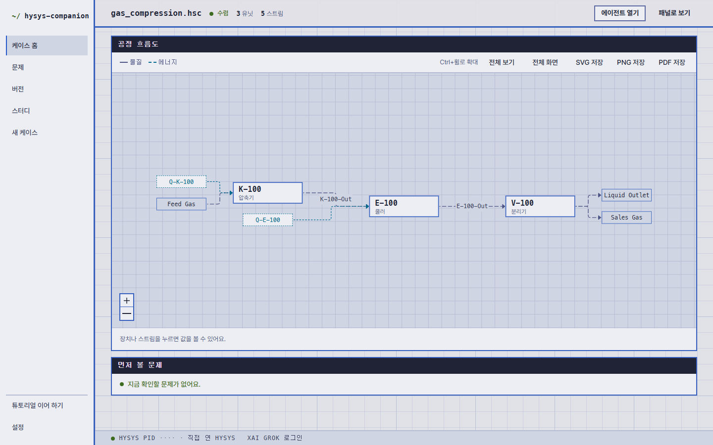
</picture>
<br><sub>케이스 홈</sub>
</td>
<td width="50%" align="center">
<picture>
  <source media="(prefers-color-scheme: dark)" srcset="assets/screens/agent-approval-dark.png">
  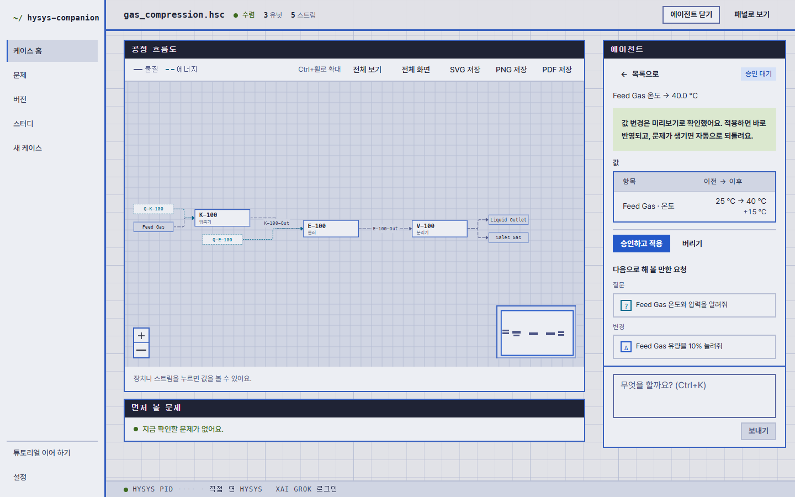
</picture>
<br><sub>에이전트 승인 대기</sub>
</td>
</tr>
<tr>
<td width="50%" align="center">
<picture>
  <source media="(prefers-color-scheme: dark)" srcset="assets/screens/newcase-revise-dark.png">
  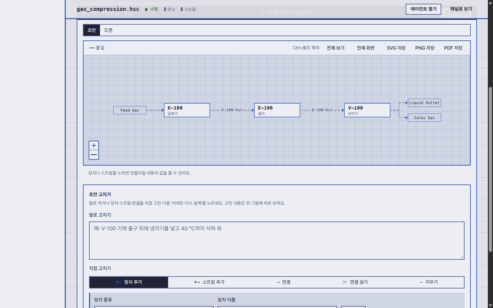
</picture>
<br><sub>초안 고치기</sub>
</td>
<td width="50%" align="center">
<picture>
  <source media="(prefers-color-scheme: dark)" srcset="assets/screens/pdf-picker-dark.png">
  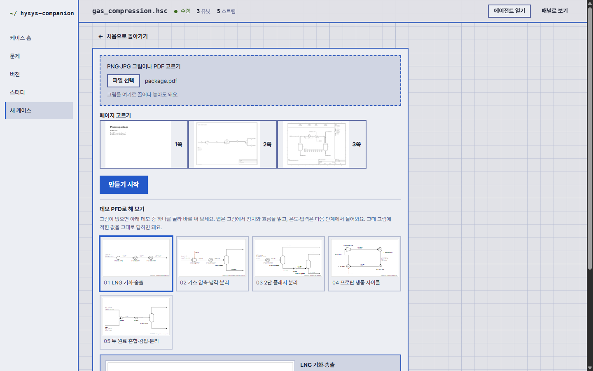
</picture>
<br><sub>PDF 쪽 고르기</sub>
</td>
</tr>
<tr>
<td width="50%" align="center">
<picture>
  <source media="(prefers-color-scheme: dark)" srcset="assets/screens/versions-dark.png">
  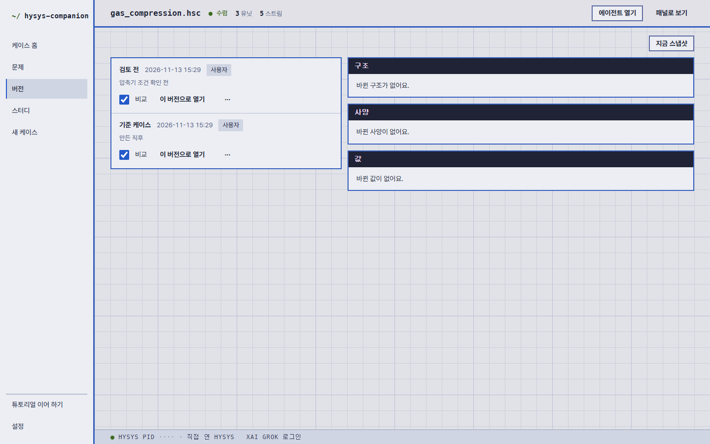
</picture>
<br><sub>버전</sub>
</td>
<td width="50%" align="center">
<picture>
  <source media="(prefers-color-scheme: dark)" srcset="assets/screens/studies-dark.png">
  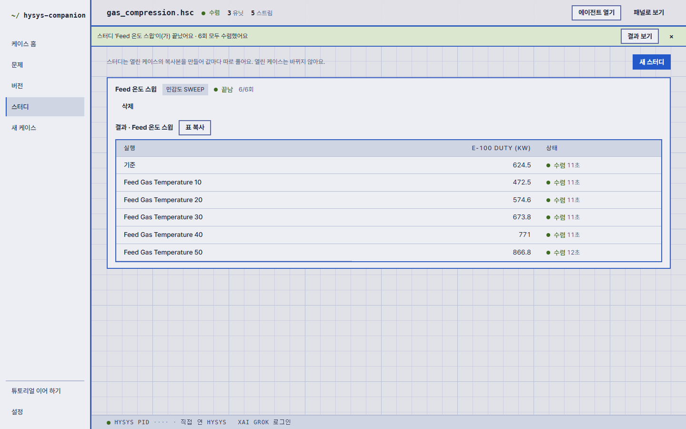
</picture>
<br><sub>스터디</sub>
</td>
</tr>
<tr>
<td width="50%" align="center">
<picture>
  <source media="(prefers-color-scheme: dark)" srcset="assets/screens/away-card-dark.png">
  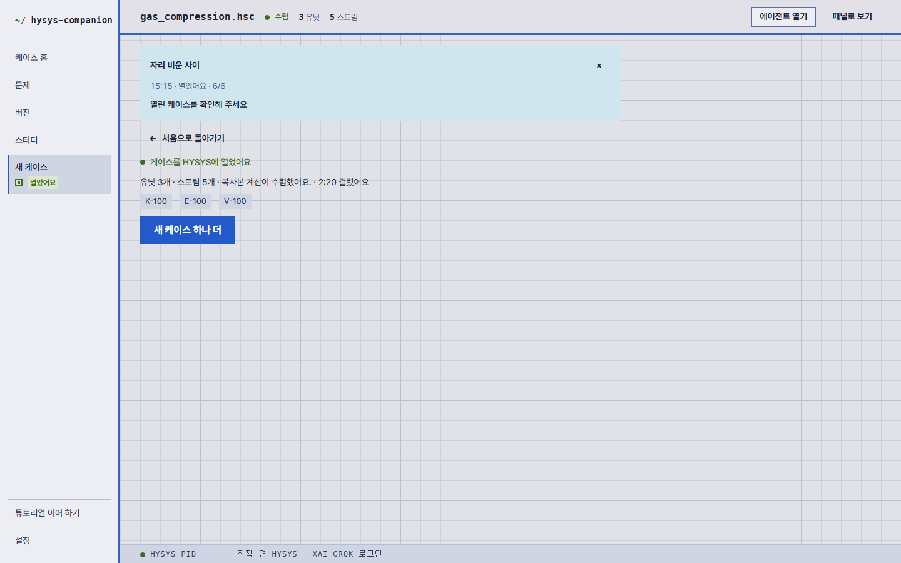
</picture>
<br><sub>자리 비운 사이</sub>
</td>
<td width="50%" align="center">
<picture>
  <source media="(prefers-color-scheme: dark)" srcset="assets/screens/settings-ai-dark.png">
  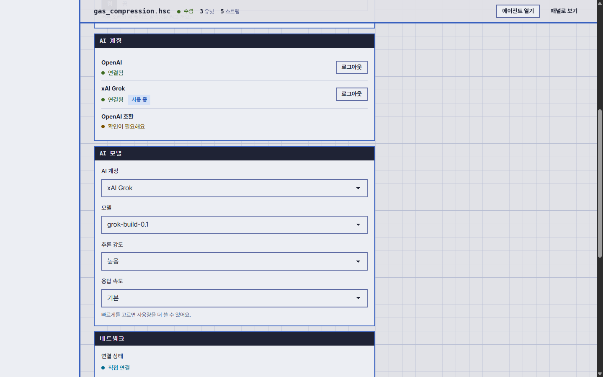
</picture>
<br><sub>AI 계정과 모델</sub>
</td>
</tr>
</table>

<sub>설치한 앱에서 찍은 화면이에요. 파일 경로와 프로세스 번호는 가렸어요.</sub>

### 이런 공정을 만들어요

<p align="center">
  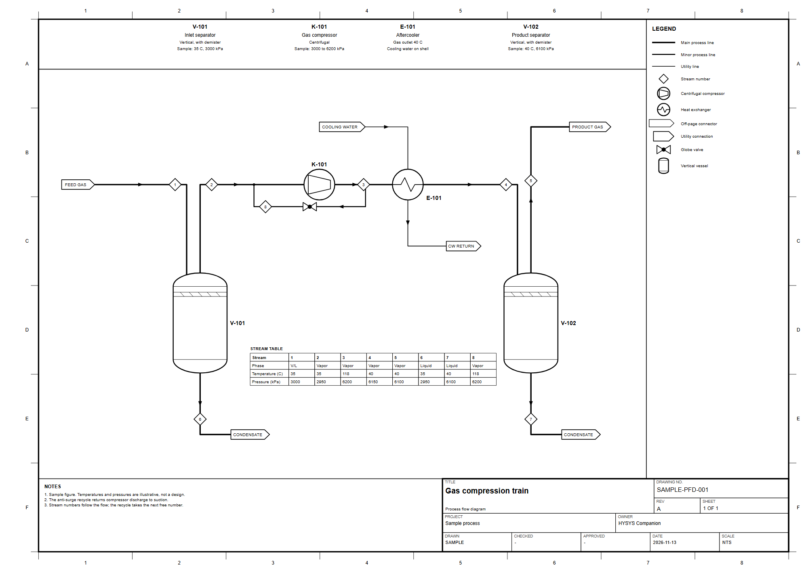
  <br>
  <sub>가스 압축 열차 예시. 온도와 압력은 예시 값이에요.</sub>
</p>

### 안전하게 쓰는 방법

- 케이스는 승인하기 전에 바뀌지 않아요. 새 케이스, 구조 변경, 스터디는 복사본에서 먼저 계산하고, 값 변경은 미리보기로 보여준 뒤 실패하면 되돌려요.
- 앱이 띄운 HYSYS만 앱이 관리해요. 직접 켠 HYSYS는 건드리지 않고 알려만 줘요.
- HYSYS에 확인 창이 떠 있으면 앱은 창을 누르지 않고 기다려요. 창 내용은 진행 카드에 보여줘요. 예외는 하나예요. 앱이 만든 확인용 복사본을 활성화할지 묻는 창에는 앱이 "아니요"로 답해요.
- 진단 정보는 설정에서 저장할 수 있어요. 키는 지우고 저장하지만 파일 경로는 남아요.

## 설치와 업데이트

1. [릴리스 페이지](https://github.com/wjgoarxiv/hysys-companion-releases/releases/latest)에서 `HYSYSCompanion_Native_Setup_<버전>.exe` 를 받아요.
2. 받은 파일의 SHA-256을 릴리스 페이지의 값과 비교해요.

   ```powershell
   Get-FileHash -Algorithm SHA256 `
     .\HYSYSCompanion_Native_Setup_<버전>.exe
   ```

3. 설치 파일을 실행해요.

**업데이트**: 설정 > 업데이트에서 새 버전을 확인해요. 받기와 설치는 직접 누를 때만 시작하고, 받은 파일의 체크섬이 맞아야 설치할 수 있어요. v0.10.39부터는 릴리스에 함께 올라간 `.sig` 서명까지 맞아야 앱 안에서 설치돼요.

이름과 로고 정책은 [TRADEMARK.md](TRADEMARK.md)에 있어요.

## 요구 사항

- Windows 10 또는 11
- Aspen HYSYS (설치된 상태)
- Microsoft Edge WebView2
- AI 기능은 설정 > AI 계정에서 연결한 계정으로 동작해요. ChatGPT와 xAI Grok은 로그인으로 연결해요.

설치 파일에 필요한 구성 요소가 들어 있어요. 별도로 Python을 설치하지 않아도 돼요.

## 자주 묻는 질문

<details>
<summary>내 케이스 파일이 바로 바뀌나요?</summary>

아니요. 승인하기 전에는 바뀌지 않아요. 값 변경은 바뀔 값을 먼저 보여주고, 승인한 뒤에만 적용하고, 되돌릴 수 있어요. 구조를 바꾸면 원본은 그대로 두고 `_vN.hsc` 새 파일을 만들어요.
</details>

<details>
<summary>HYSYS를 먼저 켜 둬야 하나요?</summary>

HYSYS가 꺼져 있으면 앱에서 바로 켤 수 있어요. 켜지면 자동으로 연결돼요. 직접 켠 HYSYS는 앱이 쓸 수 없어서, 케이스 확인이 막히면 그 HYSYS를 먼저 닫으라고 안내해요.
</details>

<details>
<summary>회사 네트워크에서 AI 연결이 안 돼요.</summary>

설정 > 네트워크에서 프록시를 자동, 수동, 직접 중에 고를 수 있어요. 연결 테스트와 네트워크 다시 잡기 버튼으로 다시 잡아 볼 수 있어요.
</details>

<details>
<summary>문제가 생기면 어떻게 하나요?</summary>

설정에서 진단 정보를 저장하고, 이 저장소의 [Issues](https://github.com/wjgoarxiv/hysys-companion-releases/issues)에 알려 주세요. 키는 지우고 저장되지만 파일 경로는 남으니, 보내기 전에 확인해 주세요.
</details>

<details>
<summary>어떤 버전에서 무엇이 바뀌었나요?</summary>

[릴리스 페이지](https://github.com/wjgoarxiv/hysys-companion-releases/releases)에 버전마다 바뀐 점이 있어요.
</details>

<details>
<summary>기여하거나 보안 문제를 알리고 싶어요.</summary>

버그 알리기, 기능 제안, 튜토리얼 고치기는 [CONTRIBUTING.md](CONTRIBUTING.md)를 보세요. 보안 문제는 공개 이슈 대신 [SECURITY.md](SECURITY.md)의 비공개 신고 양식으로 알려 주세요. 모두 [행동 강령](CODE_OF_CONDUCT.md)을 지켜 주세요. 라이선스는 [Apache License 2.0](LICENSE)이고, 이름과 로고는 [TRADEMARK.md](TRADEMARK.md)를 따라요.
</details>

<p align="right"><a href="#ko">맨 위로</a> · <a href="#en">English</a></p>

<br>

<a id="en"></a>

# English

[Download](#download) · [Intro and tutorial](#intro-and-tutorial) · [Features](#features) · [Install and update](#install-and-update) · [Requirements](#requirements) · [FAQ](#faq)

HYSYS Companion is a Windows desktop app that works beside Aspen HYSYS. Start a new case from words or a PFD picture, ask questions about the case you have open, and change it by describing the change. The app shows what will change first and applies it to HYSYS only after you approve.

This repository holds the installer, the intro and tutorial site, and a screen demo that runs on sample data. The app's engine code is not included.

## Download

**[Get the latest installer](https://github.com/wjgoarxiv/hysys-companion-releases/releases/latest)**

The installer on the release page is `HYSYSCompanion_Native_Setup_<version>.exe`. The app can also check for and download new versions itself. See [Install and update](#install-and-update).

## Intro and tutorial

See it in the browser before installing, all in one place. The Intro tab shows what the app can do in 15 slides, in Korean and English. The Tutorial tab (Korean) puts a guide bubble on a practice screen to point at the next thing to press; walk the 14 steps yourself or press "그냥 보기" (just watch).

<p align="center">
  <a href="https://wjgoarxiv.github.io/hysys-companion-releases/#tutorial">
    <picture>
      <source media="(prefers-reduced-motion: reduce) and (prefers-color-scheme: dark)" srcset="assets/tutorial/poster-dark.png">
      <source media="(prefers-reduced-motion: reduce)" srcset="assets/tutorial/poster-light.png">
      <source media="(prefers-color-scheme: dark)" srcset="assets/tutorial/tutorial-dark.webp" type="image/webp">
      <source srcset="assets/tutorial/tutorial-light.webp" type="image/webp">
      
    </picture>
  </a>
</p>

<p align="center">
  <a href="https://wjgoarxiv.github.io/hysys-companion-releases/#intro"></a>
  <a href="https://wjgoarxiv.github.io/hysys-companion-releases/#tutorial"></a>
  <a href="https://wjgoarxiv.github.io/hysys-companion-releases/ui-shell/"></a>
</p>

- **Intro and tutorial**: [https://wjgoarxiv.github.io/hysys-companion-releases/](https://wjgoarxiv.github.io/hysys-companion-releases/). New here? Start with the [Intro](https://wjgoarxiv.github.io/hysys-companion-releases/#intro) tab for 15 slides, in Korean and English. Then follow along in the [Tutorial](https://wjgoarxiv.github.io/hysys-companion-releases/#tutorial) tab (Korean only).
- **Download as HTML**: the HTML button at the top saves the intro or the tutorial you are viewing as one file that opens offline with a double-click. Direct links: [intro](https://wjgoarxiv.github.io/hysys-companion-releases/download/HYSYS-Companion-intro.html) · [tutorial](https://wjgoarxiv.github.io/hysys-companion-releases/download/HYSYS-Companion-tutorial.html). Tutorial progress in the file is kept apart from the web page.
- **Screen demo**: the app's real screen code running on sample data. Start a new case from words on an empty screen and click through the questions, the draft and the approval card. It connects to no HYSYS and no AI, so it cannot build or open a case. The code is in [`ui-shell/`](ui-shell/).

## Features

### New case: start from words or a picture

Describe the process, or upload a PFD picture (PNG, JPEG or PDF), and the app shows a draft drawing first. Revise the draft by words or by hand, then the app runs a check solve on a copy in HYSYS. When the solve finishes and you approve, the case opens.

<p align="center">
  <picture>
    <source media="(prefers-color-scheme: dark)" srcset="assets/workflow-dark.png">
    
  </picture>
</p>

<p align="center">
  <picture>
    <source media="(prefers-color-scheme: dark)" srcset="assets/screens/newcase-approval-dark.png">
    
  </picture>
  <br>
  <sub>A gas compression template waiting for approval (Korean UI)</sub>
</p>

- On the "Here is the draft" card, edit components, streams, conditions, unit values, names and the property package directly, and undo any change. Removing a component rescales every stream composition to 100%, and the pressures and temperatures you type on a stream go into HYSYS as written.
- A case that did not converge can still be opened with "Open without converging". Once open, its card lists the unconverged recycles and the streams without values. If opening fails, the draft is kept.
- Missing values are asked about with a suggested value, and every value the app filled in is shown in the result, tagged "Auto-fixed", "Default" or "AI guess".
- When you start from words, the app first looks the process up on the web and shows the pages it used on the draft card. Turn it off in Settings > Web lookup.
- If a run stops on an error or a dropped connection, "Resume from the failed step" picks it up again and keeps the draft and answers made so far.
- A progress card shows what the app is doing now, how long that usually takes, and a plain name for each step. Its cancel button really stops the run.
- Start a new case and work in another window: Windows notifications and a taskbar flash tell you when it needs approval, needs an answer, stopped or finished. A "while you were away" card summarizes what happened.
- A copy of every case you create is saved in `Documents\HYSYS Companion\cases`.
- For a PDF with several pages, pick the page to read from the page previews.
- Five demo PFDs (LNG vaporization, gas compression, two-stage flash, propane refrigeration, mixing and letdown) let you try it right away.

### Open case: ask, change, undo

- **Case home**: Shows the flowsheet of the case open in HYSYS and the "problems to look at first". It follows when you switch cases.
- **Problems**: Shows why a unit does not converge and which value to change. Applies the fix when you approve.
- **Agent**: Change values by asking, for example "Change the Feed temperature to 40 °C". It previews the before and after values, applies only after you approve, and can be undone. A structural change keeps the original and writes a new `_vN.hsc` file.
- **Questions**: Ask "What is the reflux ratio of this column?" and the answer comes from the real values in the open case. A value it cannot find is reported as not found.
- **Versions**: Save snapshots, compare two versions with values and units, open an earlier version as a new file.
- **Studies**: Run a design-case table, a value sweep and Dynamics runs one after another on copies, and get told when they finish. Dynamics (the Case home prepare card, the new-case option and Dynamics studies) is still experimental. A dynamic copy is prepared automatically for processes made of valves and separators; if a compressor or a cooler is in the way, the card names it.
- **PFD**: Click a unit or stream to see the flows in and out with their values.
- **Drawing export**: Save the flowsheet from Case home or a new-case draft as a drawing with a title block and stream table, in SVG, PNG or PDF.
- **Tutorial**: A 16-step walkthrough on the real screens that resumes where you stopped.

### A look at the screens

<table>
<tr>
<td width="50%" align="center">
<picture>
  <source media="(prefers-color-scheme: dark)" srcset="assets/screens/case-home-dark.png">
  
</picture>
<br><sub>Case home</sub>
</td>
<td width="50%" align="center">
<picture>
  <source media="(prefers-color-scheme: dark)" srcset="assets/screens/agent-approval-dark.png">
  
</picture>
<br><sub>Agent waiting for approval</sub>
</td>
</tr>
<tr>
<td width="50%" align="center">
<picture>
  <source media="(prefers-color-scheme: dark)" srcset="assets/screens/newcase-revise-dark.png">
  
</picture>
<br><sub>Revise the draft</sub>
</td>
<td width="50%" align="center">
<picture>
  <source media="(prefers-color-scheme: dark)" srcset="assets/screens/pdf-picker-dark.png">
  
</picture>
<br><sub>Pick a PDF page</sub>
</td>
</tr>
<tr>
<td width="50%" align="center">
<picture>
  <source media="(prefers-color-scheme: dark)" srcset="assets/screens/versions-dark.png">
  
</picture>
<br><sub>Versions</sub>
</td>
<td width="50%" align="center">
<picture>
  <source media="(prefers-color-scheme: dark)" srcset="assets/screens/studies-dark.png">
  
</picture>
<br><sub>Studies</sub>
</td>
</tr>
<tr>
<td width="50%" align="center">
<picture>
  <source media="(prefers-color-scheme: dark)" srcset="assets/screens/away-card-dark.png">
  
</picture>
<br><sub>While you were away</sub>
</td>
<td width="50%" align="center">
<picture>
  <source media="(prefers-color-scheme: dark)" srcset="assets/screens/settings-ai-dark.png">
  
</picture>
<br><sub>AI accounts and model</sub>
</td>
</tr>
</table>

<sub>Captured from the installed app (Korean UI). File paths and process numbers are hidden.</sub>

### The kind of process it builds

<p align="center">
  
  <br>
  <sub>A sample gas compression train. Temperatures and pressures are illustrative.</sub>
</p>

### Working safely

- Your case does not change before you approve. New cases, structural changes and studies are solved on a copy first; a value change is previewed and rolled back if it fails.
- The app manages only the HYSYS it launched. A HYSYS you started yourself is left alone and the app only tells you.
- If HYSYS shows a confirmation window, the app waits and does not click it. The window text appears on the progress card. One exception: the app answers "No" when HYSYS asks whether to activate the app's own background check copy.
- Diagnostics can be saved from Settings. Keys are removed before saving; file paths stay.

## Install and update

1. Download `HYSYSCompanion_Native_Setup_<version>.exe` from the [release page](https://github.com/wjgoarxiv/hysys-companion-releases/releases/latest).
2. Compare the file's SHA-256 with the value on the release page.

   ```powershell
   Get-FileHash -Algorithm SHA256 `
     .\HYSYSCompanion_Native_Setup_<version>.exe
   ```

3. Run the installer.

**Update**: check for a new version in Settings > Updates. Downloading and installing start only when you press the button, and installing requires the downloaded file's checksum to match. From v0.10.39 the in-app install also requires the `.sig` signature published with the release.

The name and logo policy is in [TRADEMARK.md](TRADEMARK.md).

## Requirements

- Windows 10 or 11
- Aspen HYSYS, installed
- Microsoft Edge WebView2
- AI features run on the account you connect in Settings > AI accounts. ChatGPT and xAI Grok connect by sign-in.

The installer carries what the app needs. You do not need to install Python separately.

## FAQ

<details>
<summary>Does my case file change right away?</summary>

No. Nothing changes before you approve. A value change is previewed first, applied only after you approve, and can be undone. A structural change keeps the original and writes a new `_vN.hsc` file.
</details>

<details>
<summary>Do I have to start HYSYS first?</summary>

If HYSYS is off, the app can start it for you and connects automatically. A HYSYS you started yourself cannot be used by the app; if the case check is blocked, the app tells you to close that HYSYS first.
</details>

<details>
<summary>AI will not connect on a company network.</summary>

In Settings > Network you can choose automatic, manual or direct proxy handling. The connection test and re-detect buttons let you retry.
</details>

<details>
<summary>What if something goes wrong?</summary>

Save diagnostics from Settings and report it in this repository's [Issues](https://github.com/wjgoarxiv/hysys-companion-releases/issues). Keys are removed before saving; file paths stay, so check the file first.
</details>

<details>
<summary>What changed in each version?</summary>

Each version's changes are listed on the [release page](https://github.com/wjgoarxiv/hysys-companion-releases/releases).
</details>

<details>
<summary>How can I contribute or report a security problem?</summary>

See [CONTRIBUTING.md](CONTRIBUTING.md) for bug reports, feature ideas and tutorial fixes. Report security problems through the private form in [SECURITY.md](SECURITY.md), not a public issue. Please follow the [Code of Conduct](CODE_OF_CONDUCT.md). The license is the [Apache License 2.0](LICENSE); the name and logo follow [TRADEMARK.md](TRADEMARK.md).
</details>

<br>

<p align="center">
  <a href="#ko">한국어</a> · <a href="#en">English</a> · <a href="https://github.com/wjgoarxiv/hysys-companion-releases/releases/latest">Download</a> · <a href="https://github.com/wjgoarxiv/hysys-companion-releases/releases">Releases</a> · <a href="https://github.com/wjgoarxiv/hysys-companion-releases/issues">Issues</a> · <a href="CONTRIBUTING.md">Contributing</a> · <a href="SECURITY.md">Security</a> · <a href="CODE_OF_CONDUCT.md">Code of Conduct</a> · <a href="LICENSE">License</a>
</p>

<p align="center">
  <sub>이 저장소의 내용은 <a href="LICENSE">Apache License 2.0</a>으로 배포돼요. · The contents of this repository are licensed under the <a href="LICENSE">Apache License 2.0</a>.</sub>
</p>

<p align="center">
  <sub>Designed by</sub><br>
  <a href="https://github.com/wjgoarxiv">
    <picture>
      <source media="(prefers-color-scheme: dark)" srcset="assets/woojin-go-lockup-dark.svg">
      
    </picture>
  </a><br>
  <sub><a href="https://github.com/wjgoarxiv">github.com/wjgoarxiv</a></sub>
</p>
